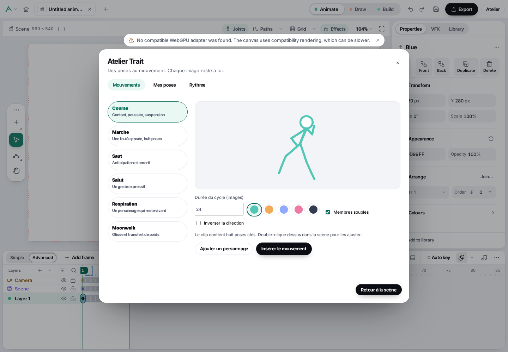

# Trait Studio

**Un studio d’animation de stickmen, libre et local.** Crée des personnages, anime leurs articulations, travaille avec l’audio et exporte tes scènes sans abonnement.

Trait Studio est une version indépendante de [StykAnimate](https://github.com/filippocalippo/StykAnimate-App), publiée sous **GPL-3.0-or-later**. Le moteur et les fonctions de base viennent de ce projet ; nos ajouts sont décrits ci-dessous. Voir [les crédits](UPSTREAM.md), [la licence](LICENSE) et [les dépendances tierces](THIRD_PARTY_NOTICES.md).



## L’atelier Trait

- **Six mouvements éditables** : course, marche, saut, salut, respiration et moonwalk. Choisis couleur, durée, souplesse et direction ; ouvre ensuite le clip pour retoucher chaque pose.
- **Personnage Élan** : tête creuse, traits fins, membres courbes et quatre contrôles IK pour déplacer mains et pieds.
- **Bibliothèque de poses** : vignettes, recherche, renommage, application au même squelette, insertion et import/export JSON.
- **Repères musicaux** : suggestion locale du tempo et de l’arrivée des basses, réglage manuel et repères visibles dans les timelines.
- **Identité indépendante** : icône propre, palette verte, profil local séparé ; aucune télémétrie distante ni connexion au catalogue amont.

## Fonctions héritées

Création de figures à partir de lignes, cercles, polygones, images et texte ; articulations, IK et étirement ; timelines simple et avancée ; calques, images clés et interpolations ; pelure d’oignon ; dessin ; caméra et effets ; pistes audio ; annuler/rétablir ; sauvegarde et récupération ; import des formats Pivot et Stick Nodes pris en charge par le moteur.

L’édition bureau propose notamment MP4, WebM, GIF, APNG et séquences d’images. Les codecs disponibles dans le navigateur dépendent de celui-ci ; l’application indique les formats utilisables. L’import de tous les fichiers propriétaires possibles n’est pas garanti.

## Télécharger

[Trait Studio 1.4.0 · Windows et Linux](https://github.com/Frozalex/trait-studio/releases/tag/v1.4.0) · [Résultats des vérifications](docs/VALIDATION-1.4.0.md)

Sur Windows, utilise **Setup-x64.exe** pour installer le programme ou **Portable-x64.exe** pour le lancer sans installation. Les exécutables ne sont pas signés numériquement.

Sur Linux, télécharge l’AppImage, rends-la exécutable, puis ouvre-la :

```bash
chmod +x TraitStudio-1.4.0-linux-x86_64.AppImage
./TraitStudio-1.4.0-linux-x86_64.AppImage
```

Les binaires macOS et les applications mobiles natives ne sont pas fournis.

## Démarrer depuis les sources

Prérequis : **Node.js 22+** et **Python 3.11+**. Les constructions automatisées utilisent Node 24.11 et Python 3.12.9.

```bash
git clone https://github.com/Frozalex/trait-studio.git
cd trait-studio
npm ci
npm run serve
```

Ouvre l’adresse affichée, normalement **http://127.0.0.1:47831**. Tout le traitement des projets se fait sur ton ordinateur. Aucun compte n’est nécessaire.

Pour lancer la fenêtre bureau Electron :

```bash
npm start
```

Avec npm 12, si l’installation du binaire Electron est bloquée, examine les scripts avec `npm install-scripts ls`, puis autorise celui du paquet officiel Electron avec `npm install-scripts approve electron`. Les fichiers natifs de distribution sont construits avec les scripts du projet ; voir [la construction bureau](docs/BUILD-TRAIT.md).

## Premier mouvement

[Guide de prise en main en français](docs/QUICKSTART.fr.md) · [Périmètre fonctionnel](docs/FEATURE-COVERAGE.md)

1. Ouvre un projet et clique **Atelier** dans la barre du haut.
2. Choisis un mouvement, ajuste sa durée et clique **Insérer le mouvement**.
3. Ouvre le clip pour modifier ses poses, puis utilise la timeline et le bouton Lecture.
4. Importe la musique avec le bouton Audio de la timeline. L’onglet **Rythme** de l’atelier permet de caler l’intro et les temps.
5. Enregistre le projet natif pour conserver les données éditables, puis exporte une vidéo.

L’atelier est actuellement en français. Les autres panneaux conservent les langues de la base ; le choix s’effectue dans les paramètres.

## Vérification

```bash
npm run check
npm test
npm run test:trait
npx playwright install chromium
npm run test:trait:browser
python3 -m unittest discover -s backend -p 'test_*.py'
```

Le test navigateur lance et arrête lui-même son serveur local. Les tests utilisent des données de démonstration, sans la musique ni les projets privés du créateur.

## État du projet

**1.4.0** poursuit la première préversion Trait Studio 1.3.0 sur une base déjà développée. Le dépôt contient les sources, les tests et les procédures de construction. Ce n’est pas une promesse de parité totale ou de supériorité sur Stick Nodes Pro.

L’analyse musicale propose des repères à vérifier à l’écoute ; elle ne garantit pas une détection correcte sur tout morceau. Les mouvements sont des points de départ éditables, à affiner selon la scène. Les applications Android/iOS natives ne sont pas fournies.

[Architecture et prochaines étapes](docs/TRAIT-STUDIO.md) · [Historique](CHANGELOG.md) · [Signaler un problème](https://github.com/Frozalex/trait-studio/issues)
